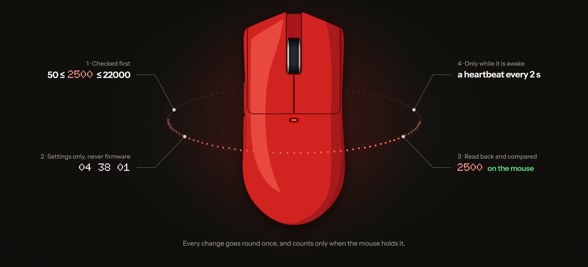

<picture>
  <source media="(prefers-color-scheme: light)" srcset="docs/media/banner-light.png">
  
</picture>

<h3 align="center"><a href="https://pilotfish.vercel.app">Open Pilotfish →</a></h3>

<p align="center">
  <a href="#features">Features</a> ·
  <a href="#at-a-glance">At a glance</a> ·
  <a href="#safe-by-design">Safe by design</a> ·
  <a href="#use-it">Use it</a> ·
  <a href="#development">Development</a>
</p>

Pilotfish is an open-source configurator for the **Attack Shark X11** wireless mouse. It runs in the browser and talks to
the mouse directly, over the USB cable, the 2.4 GHz receiver or Bluetooth. There is nothing to install and no server:
your settings go from the page to the mouse and nowhere else.

<p align="center">
  
</p>

## <picture><source media="(prefers-color-scheme: light)" srcset="docs/media/icons/heart-light.svg"></picture> Why

The X11 was my first gaming mouse, and I love it. Its official software is another story: it looks dated, it is hard to
find your way around, and even working out how a macro works takes guesswork. So I reverse-engineered the protocol and
made the app I wanted: the mouse itself is the interface. Point at a part to see what it does, touch it to change it, and
turn the mouse over to reach what is underneath.

## <a id="features"></a><picture><source media="(prefers-color-scheme: light)" srcset="docs/media/icons/zap-light.svg"></picture> Features

<table>
  <tr>
    <td width="33%" valign="top">
      <picture>
        <source media="(prefers-color-scheme: light)" srcset="docs/media/icons/mouse-light.svg">
        
      </picture><br>
      <b>The mouse is the interface</b><br>
      <sub>Every part says what it does. Touch one to change it, or turn the mouse over by hand to reach what is underneath.</sub>
    </td>
    <td width="33%" valign="top">
      <picture>
        <source media="(prefers-color-scheme: light)" srcset="docs/media/icons/sliders-light.svg">
        
      </picture><br>
      <b>Six DPI levels</b><br>
      <sub>Faders or a dial, 50 to 22,000, each level with its own colour.</sub>
    </td>
    <td width="33%" valign="top">
      <picture>
        <source media="(prefers-color-scheme: light)" srcset="docs/media/icons/lightbulb-on-light.svg">
        
      </picture><br>
      <b>Light, previewed</b><br>
      <sub>Each effect plays on the drawing and on the desk around it before you apply it.</sub>
    </td>
  </tr>
  <tr>
    <td width="33%" valign="top">
      <picture>
        <source media="(prefers-color-scheme: light)" srcset="docs/media/icons/keyboard-light.svg">
        
      </picture><br>
      <b>Buttons and macros</b><br>
      <sub>Any action or key combination, or a macro recorded from the keyboard.</sub>
    </td>
    <td width="33%" valign="top">
      <picture>
        <source media="(prefers-color-scheme: light)" srcset="docs/media/icons/bullseye-arrow-light.svg">
        
      </picture><br>
      <b>Test</b><br>
      <sub>Clicks and wheel steps counted, worn switches caught, the polling rate measured live.</sub>
    </td>
    <td width="33%" valign="top">
      <picture>
        <source media="(prefers-color-scheme: light)" srcset="docs/media/icons/reload-light.svg">
        
      </picture><br>
      <b>Apply, undo, go back</b><br>
      <sub>Every write is read back before it counts, and every setup the mouse has had is kept.</sub>
    </td>
  </tr>
  <tr>
    <td width="33%" valign="top">
      <picture>
        <source media="(prefers-color-scheme: light)" srcset="docs/media/icons/bookmarks-light.svg">
        
      </picture><br>
      <b>Profiles</b><br>
      <sub>Whole setups saved with an icon each, loaded in one click.</sub>
    </td>
    <td width="33%" valign="top">
      <picture>
        <source media="(prefers-color-scheme: light)" srcset="docs/media/icons/battery-charging-light.svg">
        
      </picture><br>
      <b>Battery</b><br>
      <sub>Its last week as a chart, and the days it has left.</sub>
    </td>
    <td width="33%" valign="top">
      <picture>
        <source media="(prefers-color-scheme: light)" srcset="docs/media/icons/radio-signal-light.svg">
        
      </picture><br>
      <b>Three ways to connect</b><br>
      <sub>The USB cable, the 2.4 GHz receiver or Bluetooth.</sub>
    </td>
  </tr>
</table>

Also polling rate, angle snap, ripple control, key response and sleep. It works offline once opened, in English and
Spanish, dark and light.

## <a id="at-a-glance"></a><picture><source media="(prefers-color-scheme: light)" srcset="docs/media/icons/eye-light.svg"></picture> At a glance

| | |
| --- | --- |
| **DPI** | 50 to 22,000, six levels, each with its own colour |
| **Polling** | 125, 250, 500 or 1000 Hz (fixed over Bluetooth) |
| **Connections** | USB cable, 2.4 GHz receiver, Bluetooth |
| **Buttons** | Eight, wheel up and down included; actions, key combinations, macros of up to 17 steps |
| **Browsers** | Chrome, Edge and Opera on Windows, macOS and Linux |
| **Runs** | In the page, no install, no server; offline once opened |
| **Languages** | English, Spanish |

## <a id="safe-by-design"></a><picture><source media="(prefers-color-scheme: light)" srcset="docs/media/icons/shield-light.svg"></picture> Safe by design

<picture>
  <source media="(prefers-color-scheme: light)" srcset="docs/media/safety-light.png">
  
</picture>

Pilotfish changes settings on a real device, so it is careful about how. It sends only the configuration reports the
official software sends; there is no firmware update or bootloader code in it at all. The setup is backed up before every
change, so any change can be taken back.

## <a id="use-it"></a><picture><source media="(prefers-color-scheme: light)" srcset="docs/media/icons/play-light.svg"></picture> Use it

You need a desktop browser with WebHID: **Chrome, Edge or Opera**. Firefox and Safari don't support it.

1. Connect the X11 with its cable or its 2.4 GHz receiver.
2. Open [Pilotfish](https://pilotfish.vercel.app), press **Connect the mouse** and pick the X11 in the browser's list. From then on it connects on its own.
3. Change what you like. Nothing is written until you press **Apply**.

> [!IMPORTANT]
> Close the official software while Pilotfish is open. Two programs talking to the mouse at once can confuse it until
> it is plugged in again.

<details>
<summary><b>Over Bluetooth</b></summary>
<br>

1. Put the power switch on **Bluetooth** and hold the **Mode** button underneath for 3 seconds, until its light blinks fast.
2. In Pilotfish press **Over Bluetooth**, then pick **X11mouse1** or **X11mouse2** in the browser's list. If your system
   offers to connect it by itself, close that offer: the browser connects it.
3. Allow the pairing if your system asks.

If it isn't in the list, your system may have it paired already: remove it in the Bluetooth settings and start again.
Browsers don't remember Bluetooth devices yet, so it is picked each time; the cable and the receiver connect on their own.

</details>

<details>
<summary><b>On Linux</b></summary>
<br>

Chrome needs permission to open the mouse. Add a udev rule, then plug it in again:

```sh
echo 'KERNEL=="hidraw*", ATTRS{idVendor}=="1d57", ATTRS{idProduct}=="fa55|fa60", TAG+="uaccess"' \
  | sudo tee /etc/udev/rules.d/70-pilotfish.rules
sudo udevadm control --reload-rules && sudo udevadm trigger
```

</details>

### <picture><source media="(prefers-color-scheme: light)" srcset="docs/media/icons/keyboard-light.svg"></picture> Keyboard

| Key | Does |
| --- | --- |
| <kbd>F</kbd> | Turn the mouse over |
| <kbd>Ctrl</kbd> + <kbd>Enter</kbd> | Apply the changes |
| <kbd>Ctrl</kbd> + <kbd>Z</kbd> | Undo the last change |
| <kbd>Esc</kbd> | Close a card, a drawer or Test |
| <kbd>↑</kbd> <kbd>↓</kbd> on a level | Step its DPI; with <kbd>Shift</kbd>, ten steps |

## <a id="development"></a><picture><source media="(prefers-color-scheme: light)" srcset="docs/media/icons/code-light.svg"></picture> Development

```sh
npm install
npm run dev     # http://localhost:5173
npm test        # protocol and backup tests, built from real USB captures
npm run build   # dist/, with the offline service worker
```

Open <http://localhost:5173/?demo> to run the whole interface against a simulated mouse, no hardware needed;
`?demo=cable` and `?demo=bluetooth` pretend those links. The demo exists only in development builds.

<details>
<summary><b>How the code is laid out</b></summary>
<br>

Pilotfish is a Svelte 5 + Vite app with no backend.

| Path | What it holds |
| --- | --- |
| `src/lib/protocol/` | Pure functions: parses reports, builds packets, checks that a read confirms a write. |
| `src/lib/device/` | The links (WebHID, Web Bluetooth, the demo) and the one place that writes to the mouse. |
| `src/lib/ui/` | The interface: the stage, the cards, the DPI dock, Test, profiles and history. |
| `src/lib/art/` | The drawing of the X11, its 3D turn in WebGL, and the mark. |
| `src/lib/i18n/` | English and Spanish. |

Protocol changes need a test built from real bytes, captured from the official software or the mouse.

</details>

## <picture><source media="(prefers-color-scheme: light)" srcset="docs/media/icons/users-light.svg"></picture> Credits

The mouse is an original illustration drawn for Pilotfish. Type: [Instrument Sans](https://fonts.google.com/specimen/Instrument+Sans)
and [Doto](https://fonts.google.com/specimen/Doto). Icons: [Pixelarticons](https://pixelarticons.com).

> [!NOTE]
> Pilotfish is an independent project. It is not affiliated with or endorsed by Attack Shark.

## <picture><source media="(prefers-color-scheme: light)" srcset="docs/media/icons/script-text-light.svg"></picture> License

[MIT](LICENSE). The bundled fonts keep their own license, the SIL Open Font License, which travels with them.
