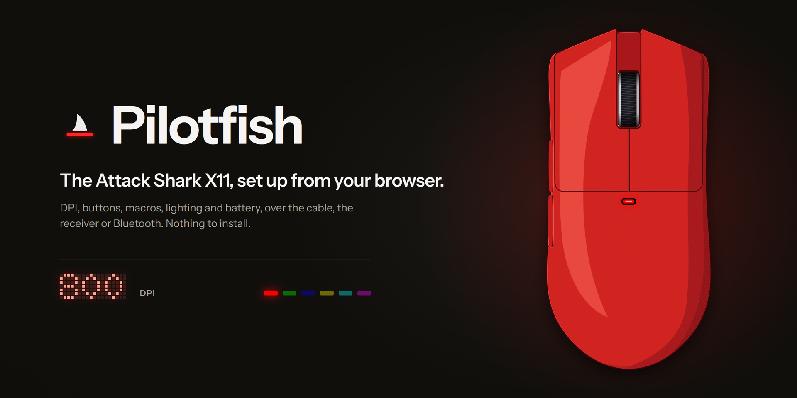
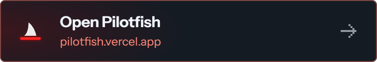
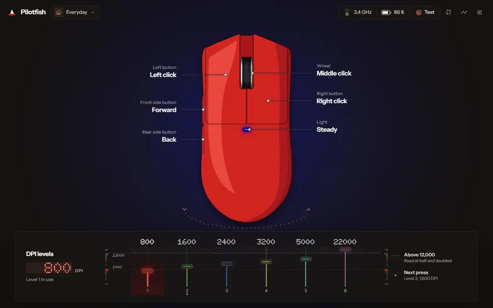

<picture>
  <source media="(prefers-color-scheme: light)" srcset="docs/media/banner-light.png">
  
</picture>

<p align="center">
  <a href="https://pilotfish.vercel.app"><picture><source media="(prefers-color-scheme: light)" srcset="docs/media/cards/open-light.png"></picture></a>
</p>

An open-source configurator for the **Attack Shark X11**. It talks to the mouse straight from the page: nothing to
install, no server, and your settings go nowhere else.

<p align="center">
  
</p>

The X11 was my first gaming mouse, and I love it. Its official software, not so much: it is dated and confusing. So I
reverse-engineered the protocol and made the app I wanted, where the mouse itself is the interface.

## <picture><source media="(prefers-color-scheme: light)" srcset="docs/media/icons/zap-light.svg"></picture> Features

<table>
  <tr>
    <td width="33%" valign="top">
      <picture><source media="(prefers-color-scheme: light)" srcset="docs/media/icons/mouse-light.svg"></picture><br>
      <b>The mouse is the interface</b><br>
      <sub>Every part says what it does. Touch one to change it; turn the mouse over for the rest.</sub>
    </td>
    <td width="33%" valign="top">
      <picture><source media="(prefers-color-scheme: light)" srcset="docs/media/icons/sliders-light.svg"></picture><br>
      <b>Six DPI levels</b><br>
      <sub>50 to 22,000 on faders or a dial, each level in its own colour.</sub>
    </td>
    <td width="33%" valign="top">
      <picture><source media="(prefers-color-scheme: light)" srcset="docs/media/icons/lightbulb-on-light.svg"></picture><br>
      <b>Light, previewed</b><br>
      <sub>Every effect plays on the drawing before you apply it.</sub>
    </td>
  </tr>
  <tr>
    <td width="33%" valign="top">
      <picture><source media="(prefers-color-scheme: light)" srcset="docs/media/icons/keyboard-light.svg"></picture><br>
      <b>Buttons and macros</b><br>
      <sub>Eight buttons: any action, key combination or a macro recorded from the keyboard.</sub>
    </td>
    <td width="33%" valign="top">
      <picture><source media="(prefers-color-scheme: light)" srcset="docs/media/icons/bullseye-arrow-light.svg"></picture><br>
      <b>Test</b><br>
      <sub>Clicks counted, worn switches caught, the polling rate measured live.</sub>
    </td>
    <td width="33%" valign="top">
      <picture><source media="(prefers-color-scheme: light)" srcset="docs/media/icons/reload-light.svg"></picture><br>
      <b>Apply, undo, go back</b><br>
      <sub>Every write is read back before it counts, and every setup is kept.</sub>
    </td>
  </tr>
  <tr>
    <td width="33%" valign="top">
      <picture><source media="(prefers-color-scheme: light)" srcset="docs/media/icons/bookmarks-light.svg"></picture><br>
      <b>Profiles</b><br>
      <sub>Whole setups, each with an icon, one click away.</sub>
    </td>
    <td width="33%" valign="top">
      <picture><source media="(prefers-color-scheme: light)" srcset="docs/media/icons/battery-charging-light.svg"></picture><br>
      <b>Battery</b><br>
      <sub>The last week as a chart, and the days it has left.</sub>
    </td>
    <td width="33%" valign="top">
      <picture><source media="(prefers-color-scheme: light)" srcset="docs/media/icons/radio-signal-light.svg"></picture><br>
      <b>Cable, receiver, Bluetooth</b><br>
      <sub>All three links, with polling up to 1000 Hz.</sub>
    </td>
  </tr>
</table>

<sub>Also angle snap, ripple control, key response and sleep. Offline once opened, in English and Spanish, dark and light.</sub>

## <picture><source media="(prefers-color-scheme: light)" srcset="docs/media/icons/shield-light.svg"></picture> Safe by design

<picture>
  <source media="(prefers-color-scheme: light)" srcset="docs/media/safety-light.png">
  
</picture>

It sends only the configuration reports the official software sends, with no firmware or bootloader code, and backs up
the setup before every change.

## <picture><source media="(prefers-color-scheme: light)" srcset="docs/media/icons/play-light.svg"></picture> Use it

1. Open [Pilotfish](https://pilotfish.vercel.app) in **Chrome, Edge or Opera** on a computer.
2. Connect the X11 by cable or receiver, press **Connect the mouse** and pick it. Next time it connects on its own.
3. Change what you like. Nothing is written until you press **Apply**.

> [!IMPORTANT]
> Close the official software first. Two programs talking to the mouse at once can confuse it until it is replugged.

<details>
<summary><b>Over Bluetooth</b></summary>
<br>

1. Put the power switch on **Bluetooth** and hold the **Mode** button underneath for 3 seconds, until its light blinks fast.
2. In Pilotfish press **Over Bluetooth**, then pick **X11mouse1** or **X11mouse2** in the browser's list. If your system
   offers to connect it by itself, close that offer: the browser connects it.
3. Allow the pairing if your system asks.

If it isn't in the list, your system may have it paired already: remove it in the Bluetooth settings and start again.
Browsers don't remember Bluetooth devices yet, so it is picked each time; the cable and the receiver connect on their own.

</details>

<details>
<summary><b>On Linux</b></summary>
<br>

Chrome needs permission to open the mouse. Add a udev rule, then plug it in again:

```sh
echo 'KERNEL=="hidraw*", ATTRS{idVendor}=="1d57", ATTRS{idProduct}=="fa55|fa60", TAG+="uaccess"' \
  | sudo tee /etc/udev/rules.d/70-pilotfish.rules
sudo udevadm control --reload-rules && sudo udevadm trigger
```

</details>

<details>
<summary><b>Keyboard shortcuts</b></summary>
<br>

| Key | Does |
| --- | --- |
| <kbd>F</kbd> | Turn the mouse over |
| <kbd>Ctrl</kbd> + <kbd>Enter</kbd> | Apply the changes |
| <kbd>Ctrl</kbd> + <kbd>Z</kbd> | Undo the last change |
| <kbd>Esc</kbd> | Close a card, a drawer or Test |
| <kbd>↑</kbd> <kbd>↓</kbd> on a level | Step its DPI; with <kbd>Shift</kbd>, ten steps |

</details>

## <picture><source media="(prefers-color-scheme: light)" srcset="docs/media/icons/code-light.svg"></picture> Development

```sh
npm install
npm run dev     # http://localhost:5173, or /?demo for a simulated mouse
npm test        # protocol and backup tests, built from real USB captures
npm run build   # dist/, with the offline service worker
```

The protocol, byte by byte, is in [docs/protocol.md](docs/protocol.md).

<details>
<summary><b>How the code is laid out</b></summary>
<br>

Pilotfish is a Svelte 5 + Vite app with no backend.

| Path | What it holds |
| --- | --- |
| `src/lib/protocol/` | Pure functions: parses reports, builds packets, checks that a read confirms a write. |
| `src/lib/device/` | The links (WebHID, Web Bluetooth, the demo) and the one place that writes to the mouse. |
| `src/lib/ui/` | The interface: the stage, the cards, the DPI dock, Test, profiles and history. |
| `src/lib/art/` | The drawing of the X11, its 3D turn in WebGL, and the mark. |
| `src/lib/i18n/` | English and Spanish. |

Protocol changes need a test built from real bytes, captured from the official software or the mouse.

</details>

---

<sub>The mouse is an original illustration. Type: [Instrument Sans](https://fonts.google.com/specimen/Instrument+Sans) and
[Doto](https://fonts.google.com/specimen/Doto). Icons: [Pixelarticons](https://pixelarticons.com). [MIT](LICENSE) license;
the bundled fonts keep the SIL Open Font License. Pilotfish is independent and not affiliated with Attack Shark.</sub>
